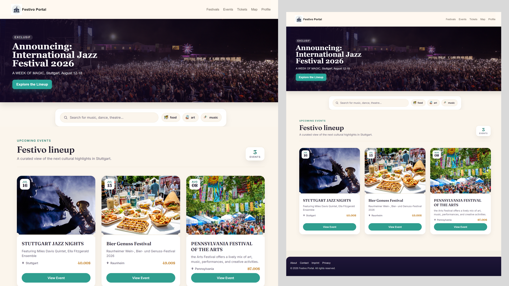

# TYPO3 Extension: Festivo (`EXT:festivo`)

A clean, modern event portal built from scratch as a TYPO3 (v12/v13 LTS) extension. I built this over a weekend to showcase a practical, real-world setup using Extbase MVC and a fast frontend filter.

---

## Live Version (Real-World Example)
I used this exact same architectural pattern—just with more complex database relationships and business logic—to build the live portfolio page for my current employer: **[Check out the live filter page here](https://www.schommer-media.de/referenzen)**

---

## How It’s Built & Tech Stack
Instead of relying on old TYPO3 habits, this extension is built around modern TYPO3 standards:

*   **Dedicated Record Storage:** Events are organized cleanly as records inside a configurable storage folder rather than cluttering the global page tree.
*   **Many-to-Many Relationships:** Demonstrates relational database handling by linking **Events** and **Tags** through an intermediate MM mapping table, alongside an N:1 **Location** relation.
*   **Fast AJAX Filtering:** Uses a dedicated TYPO3 `typeNum` endpoint to fetch filtered events asynchronously without reloading the whole page.
*   **Vanilla JS Frontend:** The search input and pill-shaped tag buttons talk directly to the TYPO3 backend using native JavaScript (`fetch` + `FormData`).

## Key Files to Look At
*   `Classes/Domain/Repository/EventRepository.php` - Contains the core query logic that handles dynamic filtering based on search inputs and active tags.
*   `Configuration/TCA/tx_festivo_domain_model_event.php` - Defines the database columns and maps them into the TYPO3 backend layout.
*   `Resources/Public/JavaScript/searchbar.js` - Handles the frontend event listeners, capturing search queries and tag clicks to send them via a POST call to the AJAX controller.
